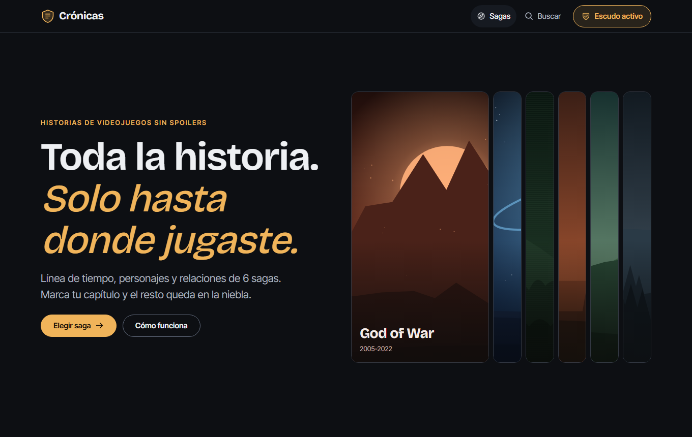
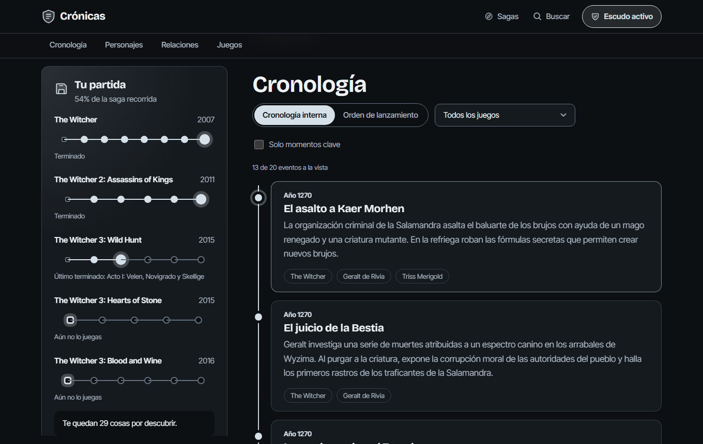
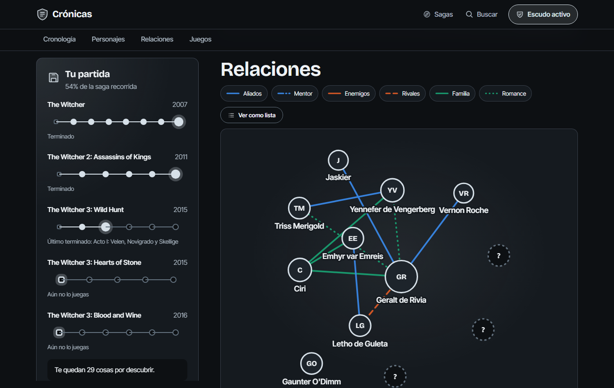
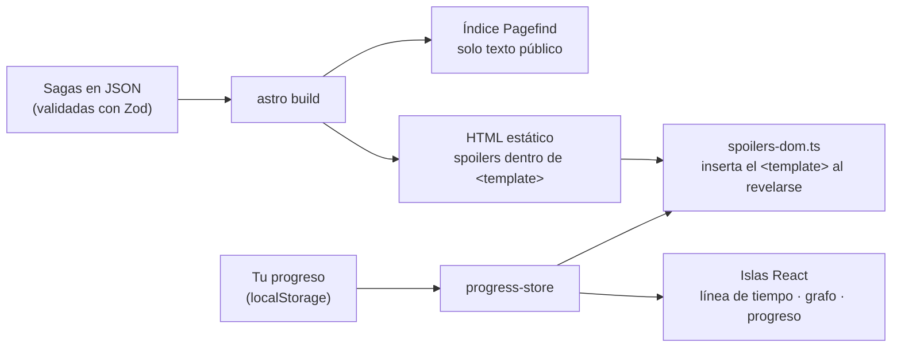

# Crónicas

**Explora la historia de tus sagas de videojuegos sin spoilers de lo que aún no has jugado.**

Línea de tiempo, personajes y mapa de relaciones de seis sagas (The Legend of Zelda, Red Dead Redemption, The Witcher, Mass Effect, Metal Gear Solid y God of War). Guardas tu partida (el último capítulo que terminaste en cada juego) y todo lo que viene después se queda **en la niebla**.

**Demo:** https://jdmahecha1.github.io/cronicas/

[](https://github.com/jdmahecha1/cronicas/actions/workflows/ci.yml)



## Qué hace

| | |
|---|---|
| **Partida guardada** | Por cada juego, un camino de puntos (uno por capítulo) que vas encendiendo. Por dentro son radios nativos: funciona con teclado y lector de pantalla. |
| **Niebla de guerra** | Cada evento, personaje, dato y relación lleva la marca del juego y la etapa en la que se descubre. Lo que aún no viviste se agrupa en bancos de niebla que puedes despejar. |
| **Línea de tiempo doble** | Cronología interna del universo (la precuela primero) u orden de lanzamiento, con filtros por juego y "solo momentos clave". |
| **Mapa de relaciones** | Grafo de fuerzas con vínculos, conflictos y afectos (colores validados para daltonismo, con el trazo como segunda pista) y una vista alternativa en lista. |
| **Identidad por saga** | Cada saga tiene su paleta (con contraste WCAG AA verificado en pruebas) y un paisaje generativo propio, dibujado con código y sin arte de los juegos. |
| **Búsqueda sin spoilers** | Índice estático con Pagefind que solo contiene texto público. |
| **Sin cuentas ni servidor** | La partida vive en `localStorage`. El sitio es HTML estático en GitHub Pages: cuesta $0. |





## Cómo funciona el escudo



La regla es una sola función pura (`src/lib/spoilers.ts`):

```ts
// Un dato descubierto durante la etapa N es visible cuando el jugador terminó esa etapa.
export function isRevealed(marker: Marker | undefined, shield: Shield): boolean {
  if (!shield.enabled || !marker) return true;
  return (shield.progress[marker.game] ?? 0) > marker.chapter;
}
```

Detalles que evitan spoilers por la puerta de atrás:

- **El texto protegido no se desenfoca, se omite.** Astro lo emite dentro de un `<template>` inerte y un script lo inserta solo cuando corresponde. Sin JavaScript, sigue oculto. (Sí está en el código fuente: el escudo protege de leer algo por accidente, no de quien lo busca a propósito).
- **Los nombres de las etapas también son spoilers** ("Acto II: La batalla de…"). Solo se muestran los de etapas terminadas o en curso; el resto aparece como "etapa 3 de 5".
- **Las relaciones esperan a los dos personajes.** Una relación marcada en el capítulo 1 no aparece si uno de los personajes se revela en el capítulo 3.
- **Los personajes cuya sola existencia es un spoiler** no ponen su nombre en el título de la pestaña ni en la búsqueda, y no aparecen en el sitemap.
- **El grafo no se mueve al avanzar.** Las posiciones se calculan con todas las relaciones y una semilla fija, así que el HTML del servidor y del cliente coinciden y revelar una conexión no reacomoda el mapa (ni delata cuántas faltan).

## Seguridad

Sin servidor, base de datos ni claves: la superficie de ataque es mínima y el hosting (GitHub Pages) absorbe el tráfico. Aun así, cada página lleva una CSP con hashes (sin `eval` ni scripts en línea ajenos), la búsqueda filtra el HTML que inserta, el progreso leído del navegador se valida, y la CI audita dependencias y prueba en el navegador que no haya violaciones de la CSP. Detalles en [SECURITY.md](SECURITY.md).

## Pila técnica

- **[Astro 7](https://astro.build)**: generación estática, una página por saga y por personaje (79 páginas).
- **React 19** en islas: partida guardada, línea de tiempo, grafo, búsqueda e interruptor del escudo, sincronizados con `useSyncExternalStore` (también entre pestañas).
- **Diseño:** Bricolage Grotesque e Inter Tight (autoalojadas), iconos de Phosphor, escalas cerradas de 7 tamaños de letra y 8 espaciados, y movimiento que respeta `prefers-reduced-motion`.
- **Zod 4**: esquema del contenido + verificación de integridad (referencias rotas, etapas inexistentes, ids duplicados). Si un JSON está mal, la compilación falla con el motivo.
- **d3-force**: disposición del grafo, calculada en el servidor.
- **Pagefind**: búsqueda estática.
- **Vitest + fast-check**: pruebas unitarias y de propiedades. **Playwright**: pruebas de punta a punta en escritorio y móvil.
- **GitHub Actions**: tipos, pruebas, compilación y e2e en cada push; publicación automática en GitHub Pages.

## Estructura

```
src/
  content/sagas/*.json      contenido: juegos, etapas, personajes, eventos, relaciones
  lib/schema.ts             esquema Zod y tipos
  lib/integrity.ts          referencias cruzadas que Zod no puede validar
  lib/spoilers.ts           reglas del escudo (funciones puras)
  lib/progress-store.ts     estado en localStorage + suscripción
  lib/graph-layout.ts       disposición determinista del grafo
  lib/themes.ts             paleta de cada saga (contraste probado en tests/themes.test.ts)
  lib/landscape.ts          paisajes generativos y deterministas
  components/               islas React y componentes Astro (SavePanel, Timeline, FogGroup…)
  scripts/spoilers-dom.ts   revela los <template> de las páginas estáticas
  pages/                    portada, saga, personaje, búsqueda, cómo funciona
tests/                      Vitest: motor, contenido, almacenamiento y grafo
e2e/                        Playwright: el escudo en el navegador real
```

## Ejecutarlo

Requiere Node 22 o superior.

```bash
npm install
npm run dev          # http://localhost:4321/cronicas/
npm test             # pruebas unitarias y validación del contenido
npm run build        # sitio estático en dist/ con índice de búsqueda
npm run preview      # sirve dist/ (la búsqueda solo funciona aquí)
npm run test:e2e     # Playwright (npx playwright install chromium la primera vez)
npm run check        # tipos de Astro y TypeScript
```

No necesita variables de entorno ni claves.

## Agregar o corregir una saga

1. Crea `src/content/sagas/<id>.json` con la forma de `src/lib/schema.ts` (los JSON existentes sirven de ejemplo).
2. Marca cada dato con `{ "game": "<id-juego>", "chapter": <índice> }`: la etapa **en la que el jugador lo descubre**. Ante la duda, usa una etapa posterior.
3. Omite `appears` en los personajes conocidos desde el principio (portada, publicidad).
4. Ejecuta `npm test`: valida el esquema, las referencias y que los textos públicos no nombren personajes ocultos.

¿Ves un error de canon? [Abre un issue](https://github.com/jdmahecha1/cronicas/issues).

## Sobre el contenido

Los resúmenes son propios. Se redactaron con ayuda de IA y después se revisaron uno por uno contra el canon. Cuando la historia depende de decisiones del jugador, se usa el desenlace más común y así se indica. No se incluyen imágenes, logos ni textos de los juegos.

Crónicas es un proyecto de fans sin ánimo de lucro y sin relación con Nintendo, Rockstar Games, CD Projekt, BioWare/EA, Konami ni Sony. Los nombres de los juegos y personajes pertenecen a sus dueños.

## Licencia

Código bajo licencia [MIT](LICENSE). Textos de `src/content/` bajo [CC BY-SA 4.0](https://creativecommons.org/licenses/by-sa/4.0/deed.es).

---

Hecho por [toriikarii](https://github.com/jdmahecha1), estudiante universitario y aprendiz del SENA (ADSO).
